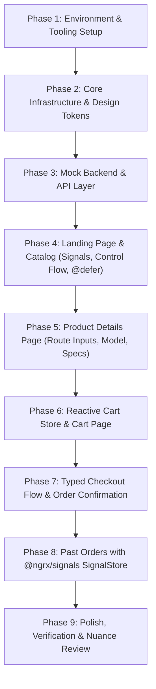

# Modern Angular (v21/v22) E-Commerce Practical Blueprint & Implementation Plan

> **Target Directory**: `/Users/abhineshgour/learning-space/abhi-agy/angular-practice-modern`  
> **Audience**: Seasoned Angular developer transitioning from legacy versions (Angular 2-15/NgModule/Zone.js) to cutting-edge Modern Angular (v18-v22 Standalone, Signals, Zoneless, Control Flow, and Resource API).  
> **Project Scope**: E-Commerce Application (Catalog, Product Details, Cart, Checkout) with Mock Backend (`json-server`).

---

## 1. Executive Summary & Paradigm Shifts (The Modern Angular Mindset)

Modern Angular (v18 through v22) represents a complete architectural renaissance. Unlike the legacy Angular framework dominated by `NgModule`, `Zone.js` dirty-checking, class-based lifecycle decorators (`@Input`, `@Output`, `@ViewChild`), and heavy RxJS async pipes for basic component state, modern Angular is:
- **Declarative & Signal-native**: State, inputs, outputs, and template variables are reactive primitives.
- **Zoneless-ready**: Eliminates Zone.js monkey-patching of the DOM and browser APIs.
- **Minimalist & Functional**: Functional dependency injection (`inject()`), functional guards/resolvers, and standalone components by default.
- **Built-in Control Flow & Deferred Views**: Native `@if`, `@for`, `@let`, and `@defer` replace structural directives and manual lazy loading.

### Paradigm Shift Cheat Sheet (Legacy vs Modern)

| Architectural Concern | Legacy Angular (v2 - v15) | Modern Angular (v18 - v22) | Why the Shift? |
| :--- | :--- | :--- | :--- |
| **Component Model** | `NgModule` required; `declarations`, `imports` in modules | Standalone by default; standalone component `imports` | Eliminates module indirection, reduces bundle sizes, enables direct tree-shaking. |
| **Change Detection** | Zone.js monkey-patches async tasks; `ChangeDetectionStrategy.OnPush` | `provideExperimentalZonelessChangeDetection()` or fine-grained Signal CD | Blazing performance, zero DOM monkey-patching overhead, easier debugging. |
| **Component Inputs** | `@Input() prop: string` + `ngOnChanges` | `prop = input<string>()` or `input.required<string>()` | Signal inputs are reactive signals. Computed values derive synchronously without lifecycle hooks. |
| **Two-way Binding** | `@Input() val` + `@Output() valChange` | `val = model<string>()` | Signal models provide two-way binding with 75% less boilerplate. |
| **Component Outputs** | `@Output() ev = new EventEmitter()` | `ev = output<string>()` | Cleaner functional output primitive without RxJS Subject overhead. |
| **DOM Queries** | `@ViewChild('el') el!: ElementRef` | `el = viewChild<ElementRef>('el')` | Query results are signals; no `ngAfterViewInit` timing bugs. |
| **Control Flow** | `*ngIf`, `*ngFor` (with `trackByFn`), `*ngSwitch` | `@if`, `@for (...; track id)`, `@empty`, `@switch` | Native compiler syntax, ~30% faster compilation, built-in `@empty` handler. |
| **Local Template Variables**| `*ngIf="obs$ | async as data"` hack | `@let total = computeTotal();` | Clean local template scoping without fake structural directives. |
| **Lazy Loading UI Chunks**| Lazy loaded routing modules only | `@defer (on viewport \| interaction)` | Ultra-fine-grained chunk splitting at the component/section level. |
| **Dependency Injection** | `constructor(private s: MyService) {}` | `private s = inject(MyService);` | Composable, functional, works in factory functions and guards. |
| **Routing & Navigation** | Class-based `CanActivate` guards, resolvers | Functional `CanActivateFn`, `withComponentInputBinding()` | Eliminates boilerplate classes; route params bind directly to signal `input()`s. |
| **Async Data Fetching** | `switchMap` / `toSignal` / `AsyncPipe` boilerplate | `resource()` and `rxResource()` | Built-in reactive query handling with `.value()`, `.isLoading()`, and `.error()`. |

---

## 2. Technology Stack & Tooling

1. **Angular**: Version 22.x (Latest Standalone & Zoneless)
   - Bootstrapped via `bootstrapApplication(AppComponent, appConfig)`
   - **Zoneless Change Detection**: `provideExperimentalZonelessChangeDetection()` (zone.js completely removed from polyfills)
   - **Modern Router**: `provideRouter(routes, withComponentInputBinding(), withViewTransitions())`
   - **Modern HTTP Client**: `provideHttpClient(withFetch(), withInterceptors([...]))`
2. **State Management**: **Dual-Pattern Architecture (Real-World Enterprise Comparison)**
   - **Native Signal Store Service** (for `Cart` and `Toast`): Built purely with Angular core primitives (`signal()`, `computed()`, `effect()`) for lightweight, zero-dependency domain state.
   - **`@ngrx/signals` SignalStore** (for `Past Orders` / `Order History`): Uses the official enterprise library (`signalStore`, `withState`, `withComputed`, `withMethods`, `withHooks`, `rxMethod`, `patchState`) to demonstrate modern declarative store slices.
3. **Styling**: **Tailwind CSS**
   - Modern utility-first styling with sleek color palette, responsive container layouts, glassmorphism, and micro-interactions
   - Modern typography, clean card/badge utilities, and responsive grid/flex setups
4. **Mock Backend**: **json-server** (v1.x)
   - Running on port `3001` with simulated network latency (`--delay 350`) for realistic loading skeleton and deferred view testing
5. **Tooling & Dev Scripts**:
   - `npm run start` -> Angular dev server (`localhost:4200`)
   - `npm run mock:api` -> json-server mock backend (`localhost:3001`)
   - `npm run dev` -> Concurrent launch of frontend and mock server

---

## 3. Architecture & Project Directory Structure

We will adopt a Domain-Driven / Feature-Sliced Architecture optimized for Modern Angular:

```text
angular-practice-modern/
├── mock-server/
│   ├── db.json                     # Products, categories, reviews, orders mock data
│   └── routes.json                 # Custom routes/rewrites (optional)
├── public/
│   └── assets/                     # Static assets, fallback product imagery
├── src/
│   ├── app/
│   │   ├── app.config.ts           # Functional application providers (Zoneless, Router, Http, Fetch)
│   │   ├── app.routes.ts           # Functional routes with lazy loading and input binding
│   │   ├── app.component.ts        # Root shell component with header and router-outlet
│   │   │
│   │   ├── core/                   # Singletons, interceptors, layout shells, global utilities
│   │   │   ├── interceptors/
│   │   │   │   ├── api-prefix.interceptor.ts    # Prepends API baseUrl
│   │   │   │   └── error-handler.interceptor.ts # Global toast error notifications
│   │   │   ├── layout/
│   │   │   │   ├── navbar/         # Signal-driven cart counter badge & navigation
│   │   │   │   └── footer/         # Modern minimalist footer
│   │   │   ├── models/
│   │   │   │   ├── product.model.ts # Product, Category, Review interfaces
│   │   │   │   ├── cart.model.ts    # CartItem, CartSummary interfaces
│   │   │   │   └── order.model.ts   # OrderPayload, ShippingAddress, PaymentDetails
│   │   │   └── services/
│   │   │       └── toast.service.ts # Signal-based notification toast manager
│   │   │
│   │   ├── features/               # Feature domains (Encapsulated smart/dumb pattern)
│   │   │   ├── products/
│   │   │   │   ├── data-access/
│   │   │   │   │   └── product.service.ts       # rxResource & resource API calls
│   │   │   │   ├── pages/
│   │   │   │   │   ├── product-list/            # Landing page catalog with filters & search
│   │   │   │   │   └── product-detail/          # PDP with gallery, quantity, specs & @defer reviews
│   │   │   │   └── ui/
│   │   │   │       ├── product-card/            # Reusable card with signal inputs & output
│   │   │   │       ├── product-filters/         # Category pills & price slider
│   │   │   │       ├── product-search/          # Debounced signal search input
│   │   │   │       └── product-reviews/         # Heavy component loaded via @defer
│   │   │   │
│   │   │   ├── cart/
│   │   │   │   ├── data-access/
│   │   │   │   │   └── cart.store.ts            # Signal-based cart state with computed totals
│   │   │   │   ├── pages/
│   │   │   │   │   └── cart-page/               # Table of items, quantity modifiers, promo code
│   │   │   │   └── ui/
│   │   │   │       ├── cart-item/               # Line item component with model input
│   │   │   │       └── order-summary/           # Computed subtotal, tax, discounts, checkout CTA
│   │   │   │
│   │   │   ├── checkout/
│   │   │   │   ├── data-access/
│   │   │   │   │   └── checkout.service.ts      # Order submission to mock API
│   │   │   │   ├── pages/
│   │   │   │   │   ├── checkout-page/           # Multi-section checkout page orchestrating steps
│   │   │   │   │   └── order-confirmation/      # Success receipt with route state data
│   │   │   │   └── ui/
│   │   │   │       ├── checkout-stepper/        # Pure visual step indicator
│   │   │   │       ├── shipping-form/           # Modern Signal Forms (createFormField, computed validation)
│   │   │   │       └── payment-selector/        # Signal-based payment method selection
│   │   │   │
│   │   │   └── orders/                     # Demonstrates @ngrx/signals SignalStore
│   │   │       ├── data-access/
│   │   │       │   ├── past-orders.store.ts     # Enterprise signalStore (withState, withMethods, rxMethod)
│   │   │       │   └── order.service.ts         # REST client fetching orders history
│   │   │       ├── pages/
│   │   │       │   └── past-orders-page/        # Order history with filters (Status, Date)
│   │   │       └── ui/
│   │   │           ├── order-card/              # Order summary card with line items & status badge
│   │   │           └── order-filter-bar/        # Status filter tabs (All, Delivered, Processing)
│   │   │
│   │   └── shared/                 # Reusable UI primitives, directives, pipes
│   │       ├── forms/
│   │       │   └── signal-form.ts  # Functional Signal Form primitives (createFormField, validators)
│   │       ├── ui/
│   │       │   ├── button/         # Button with loading spinner state
│   │       │   ├── badge/          # Status & discount tag badges
│   │       │   ├── rating-stars/   # Star rating visualization
│   │       │   ├── skeleton/       # Shimmer placeholder skeleton loader
│   │       │   └── toast/          # Global floating toast alerts
│   │       └── pipes/
│   │           └── currency-inr.pipe.ts # Custom currency formatting pipe
│   │
│   ├── styles.css                  # Global tokens, reset, typography, utility classes
│   └── main.ts                     # Entry point bootstrapping AppComponent
├── angular.json
├── package.json
├── tsconfig.json
└── PLAN.md                         # This file
```

---

## 4. Deep-Dive: Core Features & Modern Angular Implementations

### Feature 1: Landing Page & Product Catalog (Catalog Shell)
- **Concepts Demonstrated**:
  - `signal()` for active category, search query, sorting order.
  - `rxResource()` / `resource()` for reactive HTTP queries triggered automatically when search/filter signals change.
  - Modern Control Flow: `@if`, `@for (product of products(); track product.id) { ... } @empty { ... }`.
  - `@defer (on viewport)`: Lazy-loading product images and cards below the fold with `@placeholder` skeletons.
  - Debounced search: Bridging RxJS subject to signal using `toSignal()` or `effect()` with debounce time.

### Feature 2: Product Details Page (PDP)
- **Concepts Demonstrated**:
  - `withComponentInputBinding()`: Route parameter `:id` is automatically injected into the component via:
    ```typescript
    readonly id = input.required<string>(); // Reads route parameter :id reactively!
    ```
  - `rxResource()` tied directly to `id()`: Fetches product automatically whenever the ID signal changes.
  - Signal Models: `readonly quantity = model<number>(1);` enabling clean two-way quantity counter without EventEmitter ceremony.
  - Advanced `@defer`:
    ```angular-html
    @defer (on interaction(loadReviewsBtn)) {
      <app-product-reviews [productId]="product().id" />
    } @placeholder {
      <button #loadReviewsBtn class="btn-secondary">Load Customer Reviews & Ratings</button>
    } @loading (minimum 300ms) {
      <app-review-skeleton />
    } @error {
      <p class="error-text">Failed to load customer reviews.</p>
    }
    ```
  - Image preview gallery with interactive thumbnail switching using `activeImage = signal<string>(...)`.

### Feature 3: Shopping Cart Architecture (Reactive Signal Store)
- **Concepts Demonstrated**:
  - `CartStore` implemented as a clean, testable Service with Signals:
    - **State**: `items = signal<CartItem[]>(initialItems)`
    - **Computed Derivations** (automatically memoized and zero-overhead):
      - `itemCount = computed(() => this.items().reduce((acc, i) => acc + i.quantity, 0))`
      - `subtotal = computed(() => this.items().reduce((acc, i) => acc + i.product.price * i.quantity, 0))`
      - `tax = computed(() => this.subtotal() * 0.18)`
      - `shipping = computed(() => (this.subtotal() > 999 || this.subtotal() === 0 ? 0 : 99))`
      - `grandTotal = computed(() => this.subtotal() + this.tax() + this.shipping())`
    - **Persistence**: `effect(() => localStorage.setItem('cart', JSON.stringify(this.items())))`
  - Real-time cart badge in header reflecting total item count without manual event buses or async pipe leaks.
  - Cart page with item removal, quantity stepper, and quick clear.

### Feature 4: Checkout Flow & Form Architecture (Signal Forms at Shipping)
- **Concepts Demonstrated**:
  - **Signal-Based Forms (`ShippingFormComponent`)**:
    Instead of legacy mutable `FormGroup`/`FormControl` from `ReactiveFormsModule`, the shipping section uses modern **Signal Forms**:
    ```typescript
    // Shared Signal Form Primitive Helper: createFormField()
    export interface FormField<T> {
      value: WritableSignal<T>;
      touched: WritableSignal<boolean>;
      dirty: WritableSignal<boolean>;
      error: Signal<string | null>;
      isValid: Signal<boolean>;
      set: (val: T) => void;
      markTouched: () => void;
      reset: () => void;
    }

    export function createFormField<T>(
      initialValue: T,
      validators: ((val: T) => string | null)[] = []
    ): FormField<T> {
      const value = signal<T>(initialValue);
      const touched = signal(false);
      const dirty = signal(false);

      const error = computed(() => {
        const current = value();
        for (const validator of validators) {
          const err = validator(current);
          if (err) return err;
        }
        return null;
      });

      const isValid = computed(() => error() === null);

      return {
        value,
        touched,
        dirty,
        error,
        isValid,
        set: (val: T) => {
          dirty.set(true);
          value.set(val);
        },
        markTouched: () => touched.set(true),
        reset: () => {
          value.set(initialValue);
          touched.set(false);
          dirty.set(false);
        }
      };
    }
    ```
  - **Shipping Signal Form Model**:
    ```typescript
    export class ShippingFormComponent {
      readonly fullName = createFormField('', [
        required('Full name is required'),
        minLength(3, 'Name must be at least 3 characters')
      ]);
      readonly email = createFormField('', [
        required('Email is required'),
        emailValidator('Invalid email address')
      ]);
      readonly phone = createFormField('', [
        required('Phone number is required'),
        phoneValidator('Enter a valid 10-digit phone number')
      ]);
      readonly street = createFormField('', [required('Street address is required')]);
      readonly city = createFormField('', [required('City is required')]);
      readonly postalCode = createFormField('', [
        required('Postal code is required'),
        pinCodeValidator('Postal code must be 6 digits')
      ]);

      // Form-level derived validity signal:
      readonly isShippingValid = computed(() =>
        this.fullName.isValid() &&
        this.email.isValid() &&
        this.phone.isValid() &&
        this.street.isValid() &&
        this.city.isValid() &&
        this.postalCode.isValid()
      );

      // Derived form value signal:
      readonly shippingData = computed(() => ({
        fullName: this.fullName.value(),
        email: this.email.value(),
        phone: this.phone.value(),
        street: this.street.value(),
        city: this.city.value(),
        postalCode: this.postalCode.value()
      }));

      markAllTouched() {
        this.fullName.markTouched();
        this.email.markTouched();
        this.phone.markTouched();
        this.street.markTouched();
        this.city.markTouched();
        this.postalCode.markTouched();
      }
    }
    ```
  - **Template Signal Binding with `@let`**:
    ```angular-html
    <div class="form-group">
      <label for="fullName">Full Name</label>
      <input
        id="fullName"
        type="text"
        [value]="fullName.value()"
        (input)="fullName.set($any($event.target).value)"
        (blur)="fullName.markTouched()"
        class="form-input"
        placeholder="e.g. Abhinesh Gour"
      />
      @let hasError = fullName.touched() && fullName.error();
      @if (hasError) {
        <span class="field-error">{{ fullName.error() }}</span>
      }
    </div>
    ```
  - **Payment Options**: Signal-driven payment method selection (`paymentMethod = signal<'card' | 'upi' | 'cod'>('card')`).
  - **Order submission**: Once `isShippingValid()` is true, calls mock `/orders` API, clears `CartStore`, and navigates to the confirmation receipt page.

### ⚖️ Architectural Comparison: Legacy Reactive Forms vs Modern Signal Forms

| Aspect | Legacy Reactive Forms (`FormGroup`) | Modern Signal Forms (`createFormField`) |
| :--- | :--- | :--- |
| **Reactivity Primitive** | RxJS `Observable` (`valueChanges`, `statusChanges`) | Angular `Signal<T>` and `computed()` |
| **Change Detection** | Requires manual `markForCheck()` in Zoneless mode | Direct fine-grained Zoneless notifications |
| **Validation Model** | Imperative `AbstractControl` with internal status string | Pure functional `computed()` returning error string or `null` |
| **Template Binding** | `[formGroup]`, `formControlName` directives | Native `[value]="field.value()"` and `(input)="field.set(...)"` |
| **Form Validity** | `form.valid` property (sometimes out of sync in async) | Memoized `computed(() => fieldA.isValid() && fieldB.isValid())` |
| **Memory / Subscriptions** | Must unsubscribe from `valueChanges` observables | Zero subscriptions; zero leaks |

### Feature 5: Past Orders & Order History (Demonstrating `@ngrx/signals` SignalStore)
- **Concepts Demonstrated**:
  - Utilizing `@ngrx/signals` (`signalStore`)—the industry-standard external signal store for modern Angular.
  - **Declarative Extensible Architecture**:
    ```typescript
    export interface PastOrdersState {
      orders: Order[];
      filter: 'all' | 'delivered' | 'processing' | 'cancelled';
      isLoading: boolean;
      error: string | null;
    }

    export const PastOrdersStore = signalStore(
      { providedIn: 'root' },
      withState<PastOrdersState>({
        orders: [],
        filter: 'all',
        isLoading: false,
        error: null
      }),
      // 1. Computed Selectors
      withComputed(({ orders, filter }) => ({
        filteredOrders: computed(() => {
          const currentFilter = filter();
          return currentFilter === 'all'
            ? orders()
            : orders().filter(order => order.status === currentFilter);
        }),
        totalOrdersCount: computed(() => orders().length),
        lifetimeSpent: computed(() =>
          orders().reduce((sum, order) => sum + order.totalAmount, 0)
        )
      })),
      // 2. Methods & Asynchronous RxJS Integration with rxMethod
      withMethods((store, orderService = inject(OrderService)) => ({
        loadOrders: rxMethod<void>(
          pipe(
            tap(() => patchState(store, { isLoading: true, error: null })),
            exhaustMap(() =>
              orderService.fetchPastOrders().pipe(
                tapResponse({
                  next: (orders) => patchState(store, { orders, isLoading: false }),
                  error: (error: HttpErrorResponse) =>
                    patchState(store, { error: error.message, isLoading: false })
                })
              )
            )
          )
        ),
        setFilter(filter: PastOrdersState['filter']) {
          patchState(store, { filter });
        },
        cancelOrder(orderId: string) {
          orderService.cancelOrder(orderId).subscribe(() => {
            patchState(store, (state) => ({
              orders: state.orders.map(o => o.id === orderId ? { ...o, status: 'cancelled' } : o)
            }));
          });
        }
      })),
      // 3. Lifecycle Hooks
      withHooks({
        onInit(store) {
          store.loadOrders();
        }
      })
    );
    ```
  - **In-Page Experience**:
    - Status tabs (`All`, `Processing`, `Delivered`, `Cancelled`) dynamically toggling the `@ngrx/signals` store filter.
    - Order summary cards displaying line items, shipping status, and timestamps.
    - Lifetime metrics banner computed directly in the store.

### ⚖️ Architectural Comparison: Native Signals Service vs `@ngrx/signals`

| Evaluation Criteria | Native Signal Store (`CartStore`) | `@ngrx/signals` (`PastOrdersStore`) |
| :--- | :--- | :--- |
| **External Dependencies** | Zero (`@angular/core` only) | `@ngrx/signals` |
| **Boilerplate** | Minimal; custom class with signals | Structured; `signalStore()`, `withState()`, `withMethods()` |
| **State Mutation** | Direct `this.items.set(...)` / `update(...)` | Immutable `patchState(store, ...)` |
| **RxJS Integration** | Manual `effect()` / `toSignal()` | Built-in `rxMethod()` with operator chaining |
| **Extensibility & Plugins** | Custom TypeScript code | Composable features (`withEntities()`, custom store features) |
| **Ideal Production Use Case** | Local feature state, UI state, straightforward singletons | Enterprise business domains, complex entity caching, paginated collections |

---

## 5. Educational Documentation Strategy (Seasoned Dev Bridge)

Every critical file will feature **In-Source Architecture Callouts** formatted as follows:

```typescript
/**
 * -----------------------------------------------------------------------------
 * 🎓 MODERN ANGULAR PATTERN: Functional Dependency Injection & Signal Inputs
 * -----------------------------------------------------------------------------
 * 
 * ❓ WHAT IT IS:
 * We use `inject(Service)` instead of constructor injection, and `input<T>()`
 * instead of the `@Input()` decorator.
 * 
 * 🔄 OLD WAY (Angular 2 - 15):
 * export class ProductCardComponent {
 *   @Input() product!: Product;
 *   @Output() addToCart = new EventEmitter<Product>();
 *   constructor(private cartService: CartService) {}
 * }
 * 
 * 🚀 MODERN WAY (Angular 18 - 22):
 * export class ProductCardComponent {
 *   private readonly cartService = inject(CartService);
 *   readonly product = input.required<Product>();
 *   readonly addToCart = output<Product>();
 * }
 * 
 * 💡 WHY THIS DECISION WAS MADE:
 * 1. Constructor parameters required cumbersome `super()` wiring in inheritance.
 * 2. `inject()` works inside factory functions, standalone guards, and interceptors.
 * 3. Signal inputs (`input()`) guarantee reactive change detection without `ngOnChanges`.
 * 4. Signal outputs (`output()`) avoid creating RxJS Subjects unless explicitly needed.
 * 
 * 📖 OFFICIAL DOCS:
 * - https://angular.dev/guide/di/dependency-injection-context
 * - https://angular.dev/guide/signals/inputs
 * -----------------------------------------------------------------------------
 */
```

---

## 6. Mock Backend Specification (`json-server`)

The mock backend (`mock-server/db.json`) provides a realistic RESTful API:

### Endpoints
- `GET /products` - Supports querying, filtering, and pagination:
  - `GET /products?category=electronics`
  - `GET /products?q=wireless` (Full-text search)
  - `GET /products?_sort=price&_order=asc`
- `GET /products/:id` - Fetch single product with details and specs
- `GET /categories` - List of available product categories with icons/metadata
- `GET /reviews?productId=:id` - Fetch reviews for a specific product
- `GET /orders` - Fetch all past orders for order history (`_sort=date&_order=desc`)
- `POST /orders` - Submit new order (persisted to mock database)

### Sample Order Schema
```json
{
  "id": "ord-9021",
  "orderNumber": "ORD-2026-9021",
  "date": "2026-10-10T14:30:00.000Z",
  "status": "delivered",
  "totalAmount": 15098,
  "shippingAddress": {
    "fullName": "Abhinesh Gour",
    "street": "42 Tech Boulevard",
    "city": "Bengaluru",
    "postalCode": "560001"
  },
  "items": [
    {
      "productId": "prod-101",
      "title": "Quantum ANC Wireless Headphones",
      "price": 14999,
      "quantity": 1,
      "imageUrl": "https://images.unsplash.com/photo-1505740420928-5e560c06d30e?w=800&auto=format&fit=crop&q=80"
    }
  ]
}
```

### Sample Product Schema
```json
{
  "id": "prod-101",
  "title": "Quantum ANC Wireless Headphones",
  "tagline": "Studio-grade sound with 40h battery life",
  "description": "Engineered with custom 40mm beryllium drivers, active hybrid noise cancellation, and ergonomic memory foam earcups.",
  "price": 14999,
  "originalPrice": 19999,
  "discountPercent": 25,
  "category": "audio",
  "rating": 4.8,
  "ratingCount": 342,
  "inStock": true,
  "stockCount": 18,
  "imageUrl": "https://images.unsplash.com/photo-1505740420928-5e560c06d30e?w=800&auto=format&fit=crop&q=80",
  "gallery": [
    "https://images.unsplash.com/photo-1505740420928-5e560c06d30e?w=800&auto=format&fit=crop&q=80",
    "https://images.unsplash.com/photo-1484704849700-f032a568e944?w=800&auto=format&fit=crop&q=80"
  ],
  "specs": {
    "Battery Life": "40 Hours",
    "Driver Size": "40mm Beryllium",
    "Connectivity": "Bluetooth 5.3 + 3.5mm",
    "Weight": "250g"
  }
}
```

---

## 7. Step-by-Step Implementation Roadmap



### Detailed Phase Breakdown

#### Phase 1: Environment & Tooling Setup
- Initialize Angular application with `@angular/cli` using modern standalone defaults.
- Configure `tsconfig.json` for strict TypeScript checks.
- Set up `json-server` with `mock-server/db.json`.
- Add concurrent start script in `package.json` for seamless development.

#### Phase 2: Core Infrastructure & Design System
- Set up `app.config.ts` with `provideExperimentalZonelessChangeDetection()`, `provideRouter()`, `provideHttpClient(withFetch())`.
- Configure Tailwind CSS in `src/styles.css` with custom theme utilities (colors, container max-widths, animations).
- Implement `NavbarComponent` with reactive cart badge and `FooterComponent`.
- Implement `ToastService` and `ToastComponent` using signals.

#### Phase 3: Mock Backend & API Layer
- Populate `mock-server/db.json` with 12+ diverse products across categories (Audio, Wearables, Laptops, Accessories) with high-resolution imagery.
- Create core TypeScript models: `Product`, `Category`, `CartItem`, `Order`.
- Implement `ProductService` leveraging modern `HttpClient` and `rxResource`.

#### Phase 4: Product Catalog & Landing Page
- Build `ProductListComponent` featuring:
  - Hero banner with CTA.
  - Category filter pills.
  - Debounced search bar.
  - Modern `@for` loop with `@empty` block.
- Build `ProductCardComponent` using `input.required<Product>()` and `output<Product>()`.
- Apply `@defer (on viewport)` with skeleton loaders.

#### Phase 5: Product Details Page
- Register route `/products/:id` with `withComponentInputBinding()`.
- Implement `ProductDetailComponent`:
  - `id = input.required<string>()` route parameter binding.
  - Image gallery with interactive thumbnail switching.
  - Quantity counter with `model<number>()`.
  - Specs table.
  - `@defer (on interaction)` reviews section.

#### Phase 6: Reactive Cart Store & Cart Page
- Implement `CartStore` service with:
  - `items = signal<CartItem[]>`
  - `computed()` subtotal, tax, shipping, grand total.
  - `effect()` for localStorage sync.
- Build `CartPageComponent`:
  - Cart item table with quantity stepper and remove button.
  - Promo code input with instant discount calculation.
  - Order summary card with breakdown.
  - Empty cart state with CTA back to catalog.

#### Phase 7: Checkout Flow & Order Confirmation (Signal Forms)
- Implement `createFormField<T>()` signal form helper in `src/app/shared/forms/signal-form.ts`.
- Build `ShippingFormComponent` using **Signal Forms**:
  - `fullName`, `email`, `phone`, `street`, `city`, `postalCode` as individual signal form fields.
  - Computed validations per field and derived `isShippingValid` signal.
  - Clean `@let` error variable scoping in template.
- Implement payment option selector with reactive signal state (`paymentMethod = signal(...)`).
- Submit order payload to `POST /orders`, clear `CartStore`, and navigate to `OrderConfirmationComponent`.

#### Phase 8: Past Orders with `@ngrx/signals` SignalStore
- Install `@ngrx/signals`.
- Implement `PastOrdersStore`:
  - Declarative state slice: `orders`, `filter`, `isLoading`, `error`.
  - Derived computed signals: `filteredOrders`, `totalOrdersCount`, `lifetimeSpent`.
  - Asynchronous RxJS bridging via `rxMethod` and immutable `patchState`.
  - Lifecycle hook initialization: `withHooks({ onInit })`.
- Build `PastOrdersPageComponent`:
  - Interactive status filter buttons (`All`, `Processing`, `Delivered`, `Cancelled`).
  - Order card component displaying item thumbnails, pricing, date, and cancel action.
  - Real-time updates when new orders are placed during checkout.

#### Phase 9: Verification & Documentation Review
- Run end-to-end user flows in the browser (browse -> view details -> add to cart -> checkout -> view in order history).
- Verify zoneless change detection and zero console warnings.
- Confirm that every file has educational comments and documentation links.

---

## 8. Summary of Modern Best Practices Enforced

1. **No `NgModule` anywhere**: 100% standalone components, directives, and pipes.
2. **No `Zone.js` dependency**: Fully zoneless-compatible using Angular Signals.
3. **No legacy `@Input` / `@Output` decorators**: Exclusively `input()`, `output()`, and `model()`.
4. **No legacy `*ngIf` / `*ngFor`**: Exclusively `@if`, `@for (...; track ...)` and `@empty`.
5. **No class-based guards/resolvers**: Exclusively functional guards and `withComponentInputBinding()`.
6. **No constructor dependency injection**: Exclusively functional `inject()`.
7. **No unhandled RxJS memory leaks**: Leveraging Signals and `takeUntilDestroyed()` / `toSignal()` for reactive data streams.
8. **Built-in lazy loading**: `@defer` for micro-chunking heavy components.
