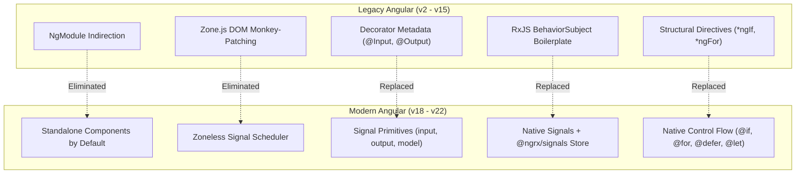
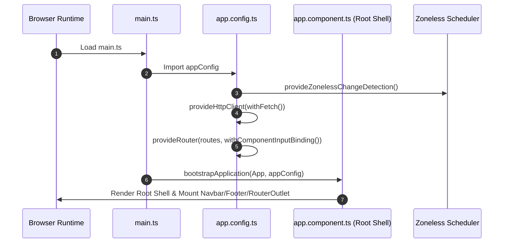
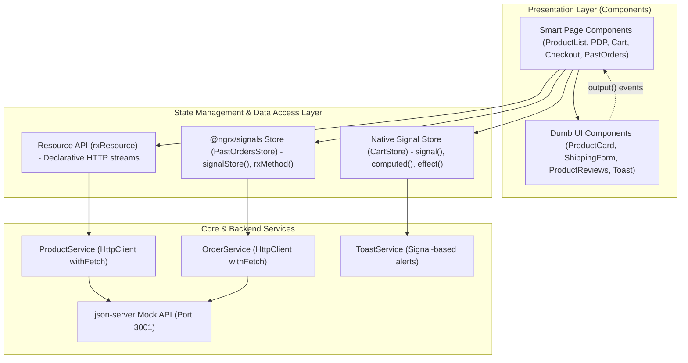
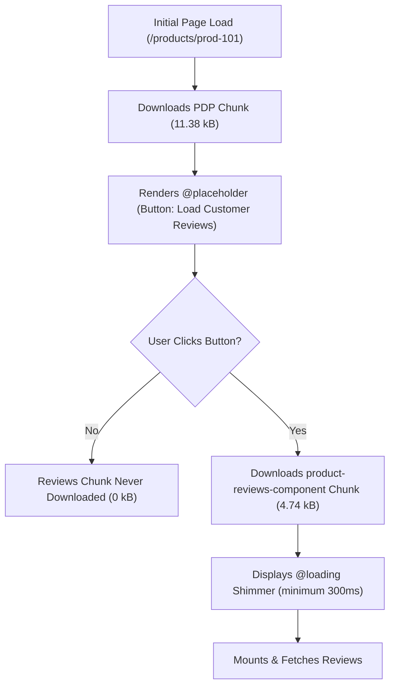
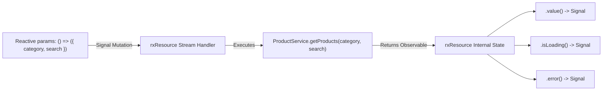
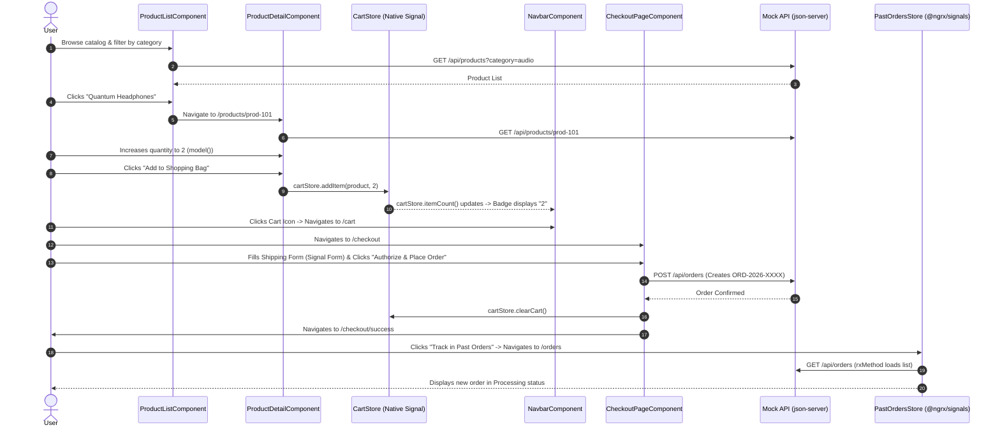
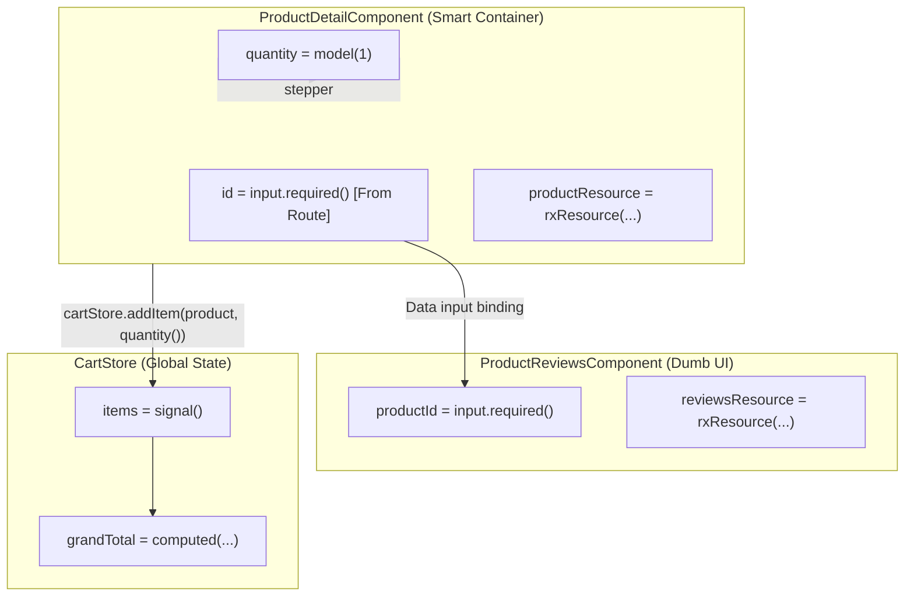
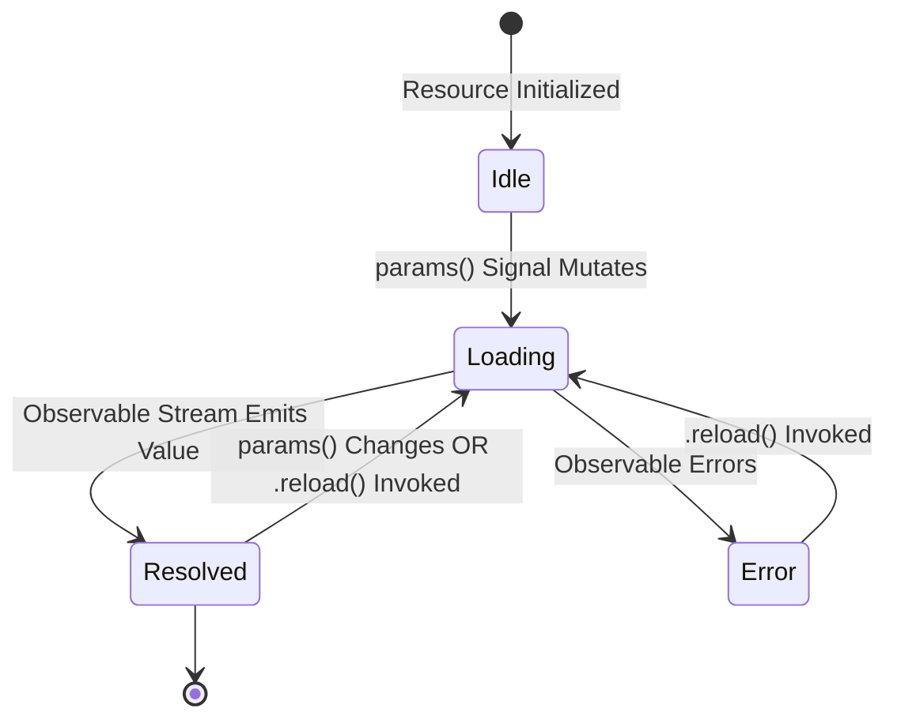
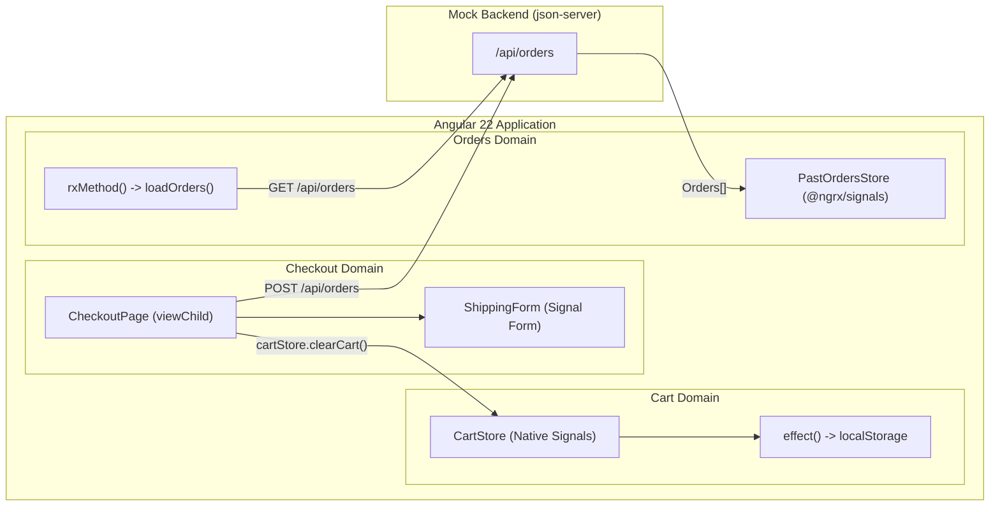
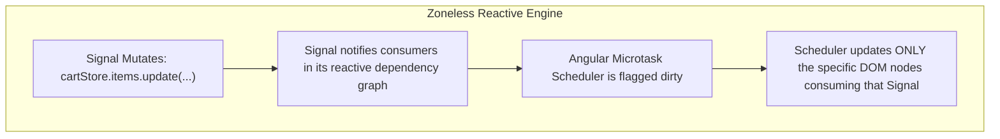

# Modern Angular (v21/v22) Architecture, Patterns & Data Flow Tutorial

> **Project**: NovaStore E-Commerce  
> **Audience**: Seasoned Angular developers (v2-v15) mastering cutting-edge Angular (v18-v22) in action.  
> **Repository Path**: `/Users/abhineshgour/learning-space/abhi-agy/angular-practice-modern`

---

## 📑 Table of Contents

1. [Executive Summary & The Modern Mental Model](#1-executive-summary--the-modern-mental-model)
2. [Bootstrapping & Application Configuration](#2-bootstrapping--application-configuration)
3. [Architecture & Feature-Sliced Directory Structure](#3-architecture--feature-sliced-directory-structure)
4. [Modern Angular Paradigms & Patterns Deep-Dive](#4-modern-angular-paradigms--patterns-deep-dive)
   - [4.1 Core Signal Primitives: `signal`, `computed`, `effect`](#41-core-signal-primitives-signal-computed-effect)
   - [4.2 Functional Component Primitives: `input`, `output`, `model`, `viewChild`](#42-functional-component-primitives-input-output-model-viewchild)
   - [4.3 Native Control Flow & Deferred Views (`@defer`)](#43-native-control-flow--deferred-views-defer)
   - [4.4 Asynchronous Data Fetching with the Resource API (`rxResource`)](#44-asynchronous-data-fetching-with-the-resource-api-rxresource)
   - [4.5 Dual State Management Architecture](#45-dual-state-management-architecture)
   - [4.6 Signal-Driven Forms (Zero `FormGroup` Overhead)](#46-signal-driven-forms-zero-formgroup-overhead)
5. [Communication & Data Flow Diagrams](#5-communication--data-flow-diagrams)
   - [5.1 End-to-End E-Commerce Flow](#51-end-to-end-e-commerce-flow)
   - [5.2 Reactive Component Communication Flow](#52-reactive-component-communication-flow)
   - [5.3 Asynchronous Resource Lifecycle Flow](#53-asynchronous-resource-lifecycle-flow)
   - [5.4 Dual Store Synchronization Flow](#54-dual-store-synchronization-flow)
6. [Zoneless Change Detection Mechanics](#6-zoneless-change-detection-mechanics)
7. [The Seasoned Developer's Rosetta Stone (Old vs Modern)](#7-the-seasoned-developers-rosetta-stone-old-vs-modern)

---

## 1. Executive Summary & The Modern Mental Model

Angular has undergone a paradigm shift between versions 16 and 22. The legacy architectural pillars—`NgModule`, `Zone.js` dirty checking, decorator-based metadata (`@Input`, `@Output`, `@ViewChild`), and heavy RxJS `AsyncPipe` boilerplate for simple local state—have been superseded by **functional, signal-native primitives**.



### Key Principles of the New Mental Model
1. **Reactivity is Fine-Grained, Not Component-Tree Wide**: Instead of re-evaluating an entire component tree top-to-bottom on any DOM event, Angular watches exact Signal dependencies.
2. **Zero `NgModule` Ceremony**: Components directly declare their dependencies via `imports: [...]`.
3. **Zoneless is the Standard**: No monkey-patching of `addEventListener`, `setTimeout`, or `fetch`.
4. **Compiler-Native Control Flow**: `@if`, `@for`, and `@defer` are compiled directly into optimized JavaScript branching instructions rather than synthetic structural directives.

---

## 2. Bootstrapping & Application Configuration

In legacy Angular, bootstrapping required loading `platformBrowserDynamic()`, compiling an `AppModule`, and importing multiple sub-modules (`HttpClientModule`, `BrowserAnimationsModule`, `RouterModule.forRoot()`).

In Modern Angular 22, bootstrapping is purely functional via `bootstrapApplication()` and `ApplicationConfig`:

### The Bootstrapping Flowchart



### Code Walkthrough: `src/main.ts`

```typescript
// src/main.ts
import { bootstrapApplication } from '@angular/platform-browser';
import { appConfig } from './app/app.config';
import { App } from './app/app.component';

// Pure standalone bootstrap with zero AppModule!
bootstrapApplication(App, appConfig)
  .catch((err) => console.error(err));
```

### Code Walkthrough: `src/app/app.config.ts`

```typescript
// src/app/app.config.ts
import {
  ApplicationConfig,
  provideZonelessChangeDetection,
  provideBrowserGlobalErrorListeners
} from '@angular/core';
import {
  provideRouter,
  withComponentInputBinding,
  withViewTransitions
} from '@angular/router';
import { provideHttpClient, withFetch } from '@angular/common/http';
import { routes } from './app.routes';

export const appConfig: ApplicationConfig = {
  providers: [
    // 1. Catches unhandled browser errors cleanly
    provideBrowserGlobalErrorListeners(),

    // 2. STABLE ZONELESS: Completely eliminates zone.js from polyfills and bundle!
    provideZonelessChangeDetection(),

    // 3. MODERN HTTP: Uses browser Fetch API under the hood instead of XMLHttpRequest
    provideHttpClient(withFetch()),

    // 4. FUNCTIONAL ROUTER:
    // - withComponentInputBinding(): route parameters (:id) map directly to input() signals!
    // - withViewTransitions(): native browser page transitions
    provideRouter(
      routes,
      withComponentInputBinding(),
      withViewTransitions()
    )
  ]
};
```

---

## 3. Architecture & Feature-Sliced Directory Structure

This project follows **Domain-Driven Slice Architecture** (Smart Pages / Dumb Components / Isolated Data Access):

```text
src/app/
├── core/                           # Singletons, Layout Shells, Global Contracts
│   ├── layout/
│   │   ├── navbar/                 # Reactive Navbar with Cart Badge
│   │   └── footer/                 # Modern Footer
│   ├── models/
│   │   ├── product.model.ts        # Product, Review, Category models
│   │   ├── cart.model.ts           # CartItem, CartSummary models
│   │   └── order.model.ts          # Order, ShippingAddress models
│   └── services/
│       └── toast.service.ts        # Signal-based global toast notifications
│
├── features/                       # Independent Domain Slices
│   ├── products/                   # Catalog & Product Details Domain
│   │   ├── data-access/
│   │   │   └── product.service.ts  # HTTP client & rxResource data queries
│   │   ├── pages/
│   │   │   ├── product-list/       # Landing catalog (signals, filters, search)
│   │   │   └── product-detail/     # PDP (route input, model(), @defer reviews)
│   │   └── ui/
│   │       ├── product-card/       # Dumb card (input.required, output)
│   │       └── product-reviews/    # Deferred reviews component (@defer target)
│   │
│   ├── cart/                       # Shopping Cart Domain
│   │   ├── data-access/
│   │   │   └── cart.store.ts       # Native Signal Store (signal, computed, effect)
│   │   └── pages/
│   │       └── cart-page/          # Bag management, promo calculation, summary
│   │
│   ├── checkout/                   # Checkout & Payment Domain
│   │   ├── pages/
│   │   │   ├── checkout-page/      # Multi-step checkout orchestrator
│   │   │   └── order-confirmation/ # Success receipt reading route state
│   │   └── ui/
│   │       └── shipping-form/      # Modern Signal Forms (createFormField, @let)
│   │
│   └── orders/                     # Past Orders & Tracking Domain
│       ├── data-access/
│       │   ├── past-orders.store.ts # Enterprise @ngrx/signals SignalStore
│       │   └── order.service.ts    # REST service for fetching/cancelling orders
│       └── pages/
│           └── past-orders-page/   # Status filters, lifetime metrics, order cards
│
└── shared/                         # Cross-cutting UI Primitives & Utilities
    ├── forms/
    │   └── signal-form.ts          # Reusable Signal Form helper & validators
    └── pipes/
        └── currency-inr.pipe.ts    # Standalone Indian Rupee currency pipe
```

### Architectural Layering



---

## 4. Modern Angular Paradigms & Patterns Deep-Dive

### 4.1 Core Signal Primitives: `signal`, `computed`, `effect`

Signals are reactive value wrappers that notify dependent consumers when their value changes:

```typescript
// 1. Writable Signal: holds state
const count = signal<number>(0);
count.set(5);                       // Direct assignment
count.update(curr => curr + 1);     // Derived assignment (now 6)

// 2. Computed Signal: read-only, synchronously memoized derivation
const doubleCount = computed(() => count() * 2); // Automatically 12!

// 3. Signal Effect: runs when any read signal changes
effect(() => {
  console.log(`Current count is: ${count()}`);
});
```

#### Real-World Example in `CartStore`:
In [cart.store.ts](file:///Users/abhineshgour/learning-space/abhi-agy/angular-practice-modern/src/app/features/cart/data-access/cart.store.ts), derived pricing calculations are zero-cost `computed()` signals:

```typescript
readonly items = signal<CartItem[]>(this.loadInitialCart());
readonly promoDiscount = signal<number>(0);

// Automatically recalculates ONLY when items() changes:
readonly subtotal = computed(() =>
  this.items().reduce((acc, item) => acc + item.product.price * item.quantity, 0)
);

// Derived from subtotal without extra events:
readonly tax = computed(() => Math.round(this.subtotal() * 0.18));

readonly shipping = computed(() => {
  const sub = this.subtotal();
  return (sub === 0 || sub > 1999) ? 0 : 149;
});

readonly grandTotal = computed(() => {
  const discounted = Math.max(0, this.subtotal() - this.promoDiscount());
  return this.items().length === 0 ? 0 : discounted + this.tax() + this.shipping();
});

// Auto-persists to localStorage via effect():
constructor() {
  effect(() => {
    localStorage.setItem('nova_cart_items', JSON.stringify(this.items()));
  });
}
```

---

### 4.2 Functional Component Primitives: `input`, `output`, `model`, `viewChild`

Legacy decorators required clumsy lifecycle hooks (`ngOnChanges`, `ngAfterViewInit`) and manual subscriptions. Modern Angular replaces them with functional signal primitives:

| Feature | Legacy Way (v2 - v15) | Modern Way (v18 - v22) | Advantage |
| :--- | :--- | :--- | :--- |
| **Component Input** | `@Input() product!: Product;` | `readonly product = input.required<Product>();` | `product()` is a Signal. You can use it in `computed()` directly! |
| **Component Output** | `@Output() add = new EventEmitter<Product>();` | `readonly add = output<Product>();` | Lightweight function call. No RxJS Subject memory allocation. |
| **Two-way Model** | `@Input() count` + `@Output() countChange` | `readonly count = model<number>(1);` | 1 line replaces 2 decorators and manual boilerplate. |
| **DOM / Child Query**| `@ViewChild('el') el!: ElementRef;` | `readonly el = viewChild.required(ChildComponent);` | Evaluated reactively as a Signal. No timing bugs with `@if`. |

#### Real-World Example in `ProductCardComponent`:
In [product-card.component.ts](file:///Users/abhineshgour/learning-space/abhi-agy/angular-practice-modern/src/app/features/products/ui/product-card/product-card.component.ts):

```typescript
export class ProductCardComponent {
  // Required signal input
  readonly product = input.required<Product>();

  // Functional output dispatcher
  readonly addToCart = output<Product>();

  onAddClick(event: MouseEvent): void {
    event.stopPropagation();
    this.addToCart.emit(this.product());
  }
}
```

#### Real-World Example: Two-Way `model()` in `ProductDetailComponent`:
In [product-detail.component.ts](file:///Users/abhineshgour/learning-space/abhi-agy/angular-practice-modern/src/app/features/products/pages/product-detail/product-detail.component.ts):

```typescript
export class ProductDetailComponent {
  // Reads :id directly from the router URL thanks to withComponentInputBinding()!
  readonly id = input.required<string>();

  // Two-way signal model for quantity
  readonly quantity = model<number>(1);

  incrementQty(): void { this.quantity.update(q => q + 1); }
  decrementQty(): void { this.quantity.update(q => Math.max(1, q - 1)); }
}
```

---

### 4.3 Native Control Flow & Deferred Views (`@defer`)

Modern Angular replaces `*ngIf`, `*ngFor`, and `*ngSwitch` with native compiler blocks:

```angular-html
<!-- Native Control Flow -->
@if (isLoading()) {
  <app-skeleton />
} @else if (error()) {
  <app-error-alert [message]="error()" />
} @else {
  @for (product of products(); track product.id) {
    <app-product-card [product]="product" />
  } @empty {
    <p>No products match your search criteria.</p>
  }
}
```

#### Local Variable Scoping with `@let`:
The new `@let` statement allows declaring scoped variables directly inside the template:

```angular-html
<!-- From src/app/features/checkout/ui/shipping-form/shipping-form.component.ts -->
@let nameErr = fullName.touched() && fullName.error();
@if (nameErr) {
  <p class="text-[11px] text-rose-400 font-medium">{{ fullName.error() }}</p>
}
```

#### Deferred Views with `@defer`:
`@defer` automatically splits child components into **separate lazy-loaded JavaScript chunks** without requiring routing modules:



```angular-html
<!-- src/app/features/products/pages/product-detail/product-detail.component.ts -->
@defer (on interaction(loadReviewsBtn)) {
  <app-product-reviews [productId]="product.id" />
} @placeholder {
  <button #loadReviewsBtn class="btn-secondary">
    Load Customer Reviews (Lazy @defer Chunk)
  </button>
} @loading (minimum 300ms) {
  <div class="animate-pulse">Loading deferred reviews module chunk...</div>
} @error {
  <div class="text-rose-400">Failed to load deferred reviews view chunk.</div>
}
```

---

### 4.4 Asynchronous Data Fetching with the Resource API (`rxResource`)

In legacy Angular, component data loading required manual RxJS pipelines with `switchMap`, `catchError`, `tap`, `takeUntilDestroyed`, and tracking boolean `loading = true/false` variables manually.

Modern Angular 22 introduces the **Resource API** (`rxResource` in `@angular/core/rxjs-interop`):



#### Real-World Implementation in `ProductListComponent`:
In [product-list.component.ts](file:///Users/abhineshgour/learning-space/abhi-agy/angular-practice-modern/src/app/features/products/pages/product-list/product-list.component.ts):

```typescript
export class ProductListComponent {
  private readonly productService = inject(ProductService);

  readonly selectedCategory = signal<string>('all');
  readonly searchQuery = signal<string>('');

  // 🎓 rxResource automatically re-triggers stream() whenever params() change!
  readonly productsResource = rxResource<Product[], { category: string; search: string }>({
    params: () => ({
      category: this.selectedCategory(),
      search: this.searchQuery()
    }),
    stream: ({ params }) =>
      this.productService.getProducts(params.category, params.search)
  });
}
```

In the template, consumption is clean and declarative:

```angular-html
@if (productsResource.isLoading()) {
  <div class="animate-pulse">Loading products...</div>
}

@if (productsResource.error()) {
  <button (click)="productsResource.reload()">Retry Connection</button>
}

@if (!productsResource.isLoading() && productsResource.value(); as products) {
  @for (product of products; track product.id) {
    <app-product-card [product]="product" />
  }
}
```

---

### 4.5 Dual State Management Architecture

To prepare you for enterprise real-world applications, this project demonstrates **both** dominant state management patterns:

```text
┌─────────────────────────────────────────────────────────────────────────────────┐
│                           State Management Paradigms                             │
├───────────────────────────────────────┬─────────────────────────────────────────┤
│         Native Signal Store           │          @ngrx/signals Store            │
│       (features/cart/data-access)     │      (features/orders/data-access)      │
├───────────────────────────────────────┼─────────────────────────────────────────┤
│ • Zero external dependencies          │ • Official enterprise modular library   │
│ • Directly uses signal(), computed()  │ • signalStore() + withState()           │
│ • Immutable updates via update()      │ • patchState() immutable transitions    │
│ • Perfect for Cart, UI, Notification  │ • rxMethod() handles async streams      │
│   state and lightweight services      │ • Perfect for complex entity caching    │
└───────────────────────────────────────┴─────────────────────────────────────────┘
```

#### Deep-Dive: `@ngrx/signals` in `PastOrdersStore`
In [past-orders.store.ts](file:///Users/abhineshgour/learning-space/abhi-agy/angular-practice-modern/src/app/features/orders/data-access/past-orders.store.ts):

```typescript
export interface PastOrdersState {
  orders: Order[];
  filter: OrderFilter;
  isLoading: boolean;
  error: string | null;
}

export const PastOrdersStore = signalStore(
  { providedIn: 'root' },
  withState<PastOrdersState>({
    orders: [],
    filter: 'all',
    isLoading: false,
    error: null
  }),

  // 1. Computed Selectors
  withComputed(({ orders, filter }) => ({
    filteredOrders: computed(() => {
      const active = filter();
      const all = orders();
      return active === 'all' ? all : all.filter(o => o.status === active);
    }),
    totalOrdersCount: computed(() => orders().length),
    lifetimeSpent: computed(() =>
      orders()
        .filter(o => o.status !== 'cancelled')
        .reduce((sum, o) => sum + o.totalAmount, 0)
    )
  })),

  // 2. Methods & Asynchronous RxJS Pipelines (rxMethod)
  withMethods((store, orderService = inject(OrderService), toast = inject(ToastService)) => ({
    loadOrders: rxMethod<void>(
      pipe(
        tap(() => patchState(store, { isLoading: true, error: null })),
        exhaustMap(() =>
          orderService.fetchPastOrders().pipe(
            tap({
              next: (orders) => patchState(store, { orders, isLoading: false }),
              error: (err: Error) => patchState(store, { error: err.message, isLoading: false })
            })
          )
        )
      )
    ),

    setFilter(filter: OrderFilter): void {
      patchState(store, { filter });
    },

    cancelOrder(orderId: string): void {
      orderService.cancelOrder(orderId).subscribe({
        next: () => {
          patchState(store, (state) => ({
            orders: state.orders.map(o => o.id === orderId ? { ...o, status: 'cancelled' } : o)
          }));
          toast.info('Order Cancelled', `Order #${orderId} was updated.`);
        }
      });
    }
  })),

  // 3. Lifecycle Hooks
  withHooks({
    onInit(store) {
      store.loadOrders(); // Auto-fetches orders when store initializes!
    }
  })
);
```

---

### 4.6 Signal-Driven Forms (Zero `FormGroup` Overhead)

In modern Angular, form state can be modelled directly using Signals without importing `ReactiveFormsModule` or managing complex `AbstractControl` subscriptions:

#### 1. Reusable Signal Form Helper (`src/app/shared/forms/signal-form.ts`)

```typescript
export function createFormField<T>(
  initialValue: T,
  validators: ValidatorFn<T>[] = []
): FormField<T> {
  const value = signal<T>(initialValue);
  const touched = signal<boolean>(false);
  const dirty = signal<boolean>(false);

  // Pure computed error calculation:
  const error = computed(() => {
    const current = value();
    for (const validator of validators) {
      const err = validator(current);
      if (err) return err;
    }
    return null;
  });

  const isValid = computed(() => error() === null);

  return {
    value,
    touched,
    dirty,
    error,
    isValid,
    set: (val: T) => { dirty.set(true); value.set(val); },
    markTouched: () => touched.set(true),
    reset: () => { value.set(initialValue); touched.set(false); dirty.set(false); }
  };
}
```

#### 2. Usage in `ShippingFormComponent`:
In [shipping-form.component.ts](file:///Users/abhineshgour/learning-space/abhi-agy/angular-practice-modern/src/app/features/checkout/ui/shipping-form/shipping-form.component.ts):

```typescript
export class ShippingFormComponent {
  readonly fullName = createFormField('', [
    required('Full name is required'),
    minLength(3, 'At least 3 characters')
  ]);
  readonly email = createFormField('', [required(), emailValidator()]);
  readonly phone = createFormField('', [required(), phoneValidator()]);
  readonly street = createFormField('', [required()]);
  readonly city = createFormField('', [required()]);
  readonly postalCode = createFormField('', [required(), pinCodeValidator()]);

  // Derived Form-Wide Validity Signal:
  readonly isShippingValid = computed(() =>
    this.fullName.isValid() &&
    this.email.isValid() &&
    this.phone.isValid() &&
    this.street.isValid() &&
    this.city.isValid() &&
    this.postalCode.isValid()
  );
}
```

---

## 5. Communication & Data Flow Diagrams

### 5.1 End-to-End E-Commerce Flow



---

### 5.2 Reactive Component Communication Flow



---

### 5.3 Asynchronous Resource Lifecycle Flow



---

### 5.4 Dual Store Synchronization Flow



---

## 6. Zoneless Change Detection Mechanics

### The Core Problem in Legacy Angular (Zone.js)
In legacy Angular, `Zone.js` monkey-patches every asynchronous browser API (`window.setTimeout`, `addEventListener`, `Promise`, `XMLHttpRequest`). Whenever *any* callback fires—even an irrelevant `mousemove` or an internal timer:
1. `Zone.js` intercepted the callback.
2. It told Angular: *"Something async happened, check the entire application!"*
3. Angular traversed the **entire component tree from root to leaves**, checking for dirty bindings.

### How Zoneless Works in Modern Angular 22
Modern Angular with `provideZonelessChangeDetection()` completely removes this overhead:



### Why Zoneless is Superior
1. **Lighter Bundles**: Removes `zone.js` (~15-20 kB gzipped).
2. **Instant Performance**: No redundant DOM traversals on unrelated events.
3. **Easier Debugging**: Stack traces show the exact call stack rather than 50 frames of `zone.js:drainMicroTaskQueue`.
4. **Standard Web Compatibility**: Modern web APIs (async/await, Web Workers, Custom Elements) run natively without patching.

---

## 7. The Seasoned Developer's Rosetta Stone (Old vs Modern)

Use this reference table whenever you need to translate an old Angular pattern into Modern Angular 22:

| Task / Feature | Legacy Angular (v2 - v15) | Modern Angular (v18 - v22) |
| :--- | :--- | :--- |
| **Bootstrapping** | `platformBrowserDynamic().bootstrapModule(AppModule)` | `bootstrapApplication(App, appConfig)` |
| **Dependency Injection** | `constructor(private http: HttpClient) {}` | `private readonly http = inject(HttpClient);` |
| **Passing Input** | `@Input() count: number = 0;` | `readonly count = input<number>(0);` |
| **Required Input** | `@Input({ required: true }) item!: Item;` | `readonly item = input.required<Item>();` |
| **Emitting Output** | `@Output() change = new EventEmitter<string>();` | `readonly change = output<string>();` |
| **Two-Way Binding** | `@Input() val` + `@Output() valChange` | `readonly val = model<string>();` |
| **DOM / View Child** | `@ViewChild('myBtn') myBtn!: ElementRef;` | `readonly myBtn = viewChild.required('myBtn');` |
| **Conditional Render** | `<div *ngIf="isLoggedIn; else loginTpl">` | `@if (isLoggedIn()) { ... } @else { ... }` |
| **Looping Collections** | `<li *ngFor="let item of items; trackBy: trackFn">` | `@for (item of items(); track item.id) { ... } @empty { ... }` |
| **Local Variables** | `<ng-container *ngIf="user$ \| async as user">` | `@let user = activeUser();` |
| **Lazy Loading Chunks**| Lazy loaded `RouterModule.forChild(...)` | `@defer (on viewport \| interaction) { <app-heavy /> }` |
| **Route Params** | `this.route.paramMap.subscribe(p => id = p.get('id'))` | `readonly id = input.required<string>();` (`withComponentInputBinding`) |
| **Derived State** | `get total() { return this.calc(); }` or RxJS `combineLatest` | `readonly total = computed(() => this.items().reduce(...));` |
| **Side Effects / Sync** | `ngOnInit()` subscribe + `ngOnDestroy()` unsubscribe | `effect(() => localStorage.setItem('k', JSON.stringify(this.s())))` |
| **State Management** | Actions, Reducers, Effects, Selectors (4 files) | `@ngrx/signals`: `signalStore(withState, withComputed, withMethods)` |
| **Data Fetching** | `switchMap` / `toSignal` / `AsyncPipe` boilerplate | `rxResource({ params: () => ..., stream: ({ params }) => ... })` |
| **Forms** | `FormGroup`, `FormControl`, `ReactiveFormsModule` | Signal Forms (`createFormField`, reactive computed validation) |

---

## 🏁 Summary

You now have a production-grade, architectural reference demonstrating every modern Angular 22 capability:
- **Standalone architecture** with zero modules.
- **Zoneless change detection** with Angular Signals.
- **Dual State patterns**: Native Signal Store (`CartStore`) and Enterprise `@ngrx/signals` Store (`PastOrdersStore`).
- **Signal-driven forms** and the Resource API (`rxResource`).
- **Fine-grained lazy loading** via `@defer`.

All code is fully compiled, runnable, and commented with doc links across the [angular-practice-modern](file:///Users/abhineshgour/learning-space/abhi-agy/angular-practice-modern) codebase.
